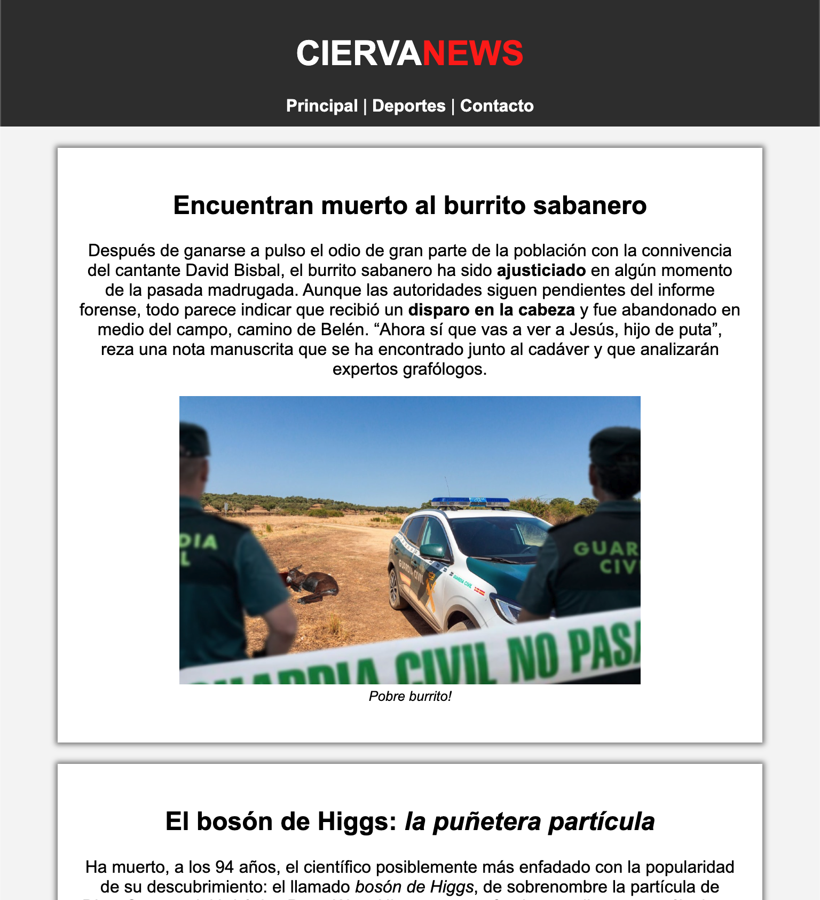
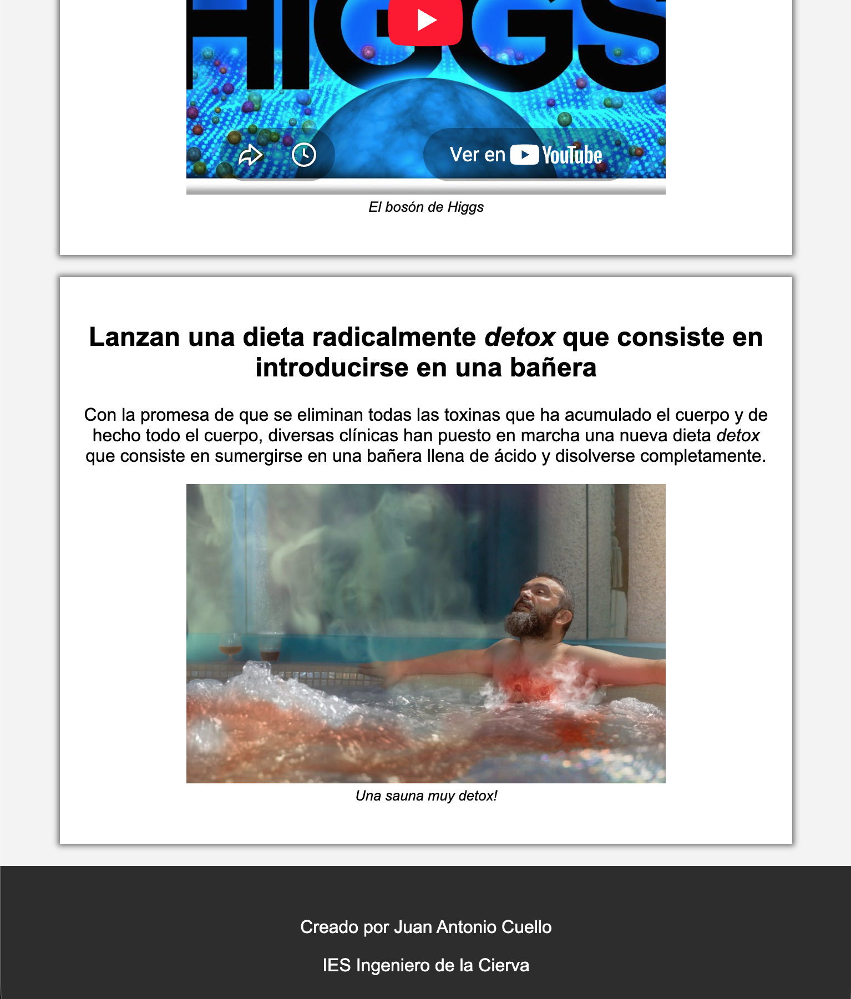
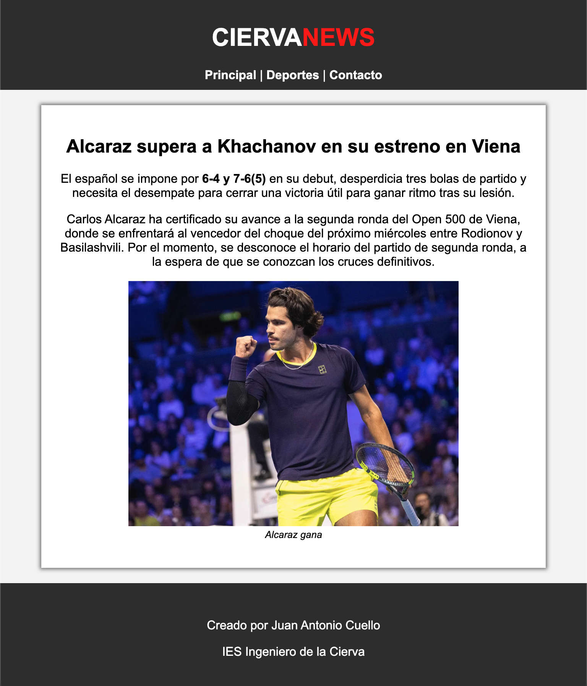
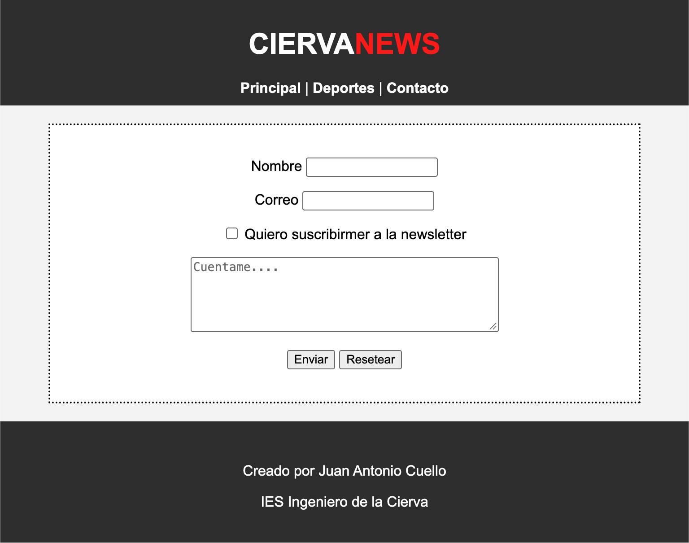

# Ejercicio01 - CiervaNEWS1

## Enunciado
Hacer la siguiente web de noticias formada por tres páginas html.
- index.html
- deportes.html
- contacto.html  

En las tres páginas tendrás el menú para viajar entre ellas. Se te proporciona el css para que visualmente quede como en la imagen.


---

**Página index.html**
Página de inicio. Dispone de los tres artículos del ejercicio ya hecho, solo que le hemos añadido imáganes y un video de youtube. Como las imágenes tienen píe de imagen, debes usar `<figure>`.




---

**Página deportes.html**
Crea un artículo de deportes. Lo que quieras. Busca la foto de Internet.



---

**Página contacto.html**
Crea el formulario de contacto que puedes ver en la imagen.




## CSS de ayuda
Revisa el CSS que te proporciono y con el profesor, trata de entender todas las propiedades. Algunas reglas y propiedadades css ya las has usado en los ejercicios anteriores.


```css
body {
      font-family: Arial, Helvetica, sans-serif;
      margin:0px;
      text-align: center;
      background-color: whitesmoke;     
}
  
header{
    background-color: #333;
    color: white;
    padding-bottom: 10px;
    padding-top: 10px;
}

footer{
    background-color: #333;
    color:white;
    padding-top: 30px;
    padding-bottom: 20px;
}


main{
    max-width: 700px;
    margin:auto;    
}


article{
    background-color: white;
    box-shadow: 0px 0px 5px 2px grey;
    margin: 20px;
    padding: 20px;  
}

figcaption{
    font-size: 0.8rem;
    font-style: italic;
}

/*menu*/


a {
    font-weight: bold;;
    text-decoration: none;
    color: inherit;
}
a:hover{
    text-decoration: underline;
}

/*formulario*/
form{
    background-color: white;
    border: 2px dotted black;
    margin: 20px;
    padding: 20px; 

}

```

