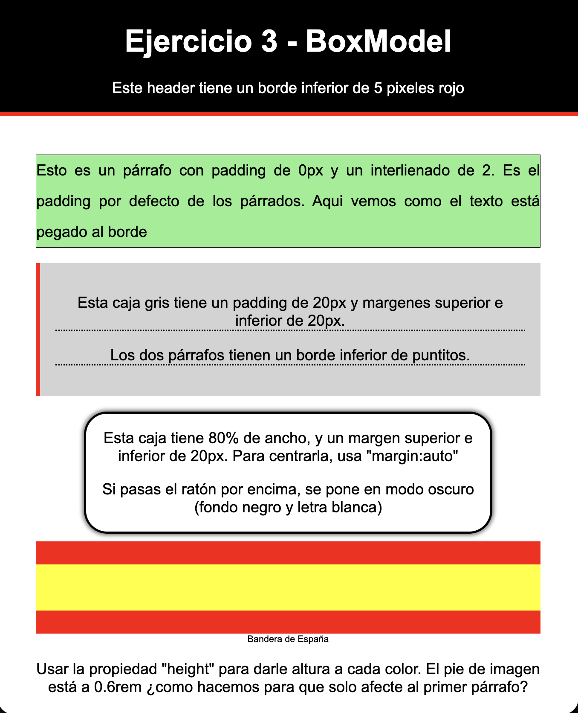
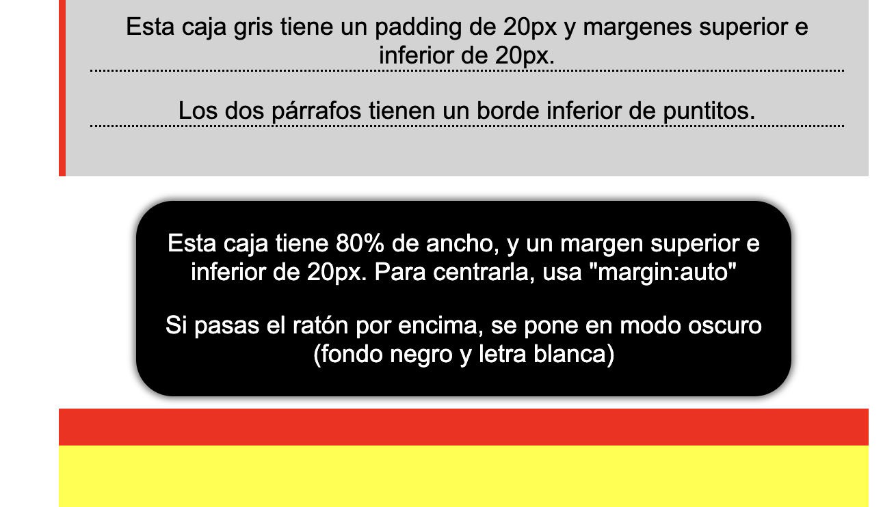

# Ejercicio BOX MODEL

**Sin modificar el HTML**, modifica el css aplicando reglas hasta llegar a la solucíon indicada.   

Fijate en lo que pone en cada caja, que te indicará parte de los estilos a aplicar. 

Al pasar el ratón por la tercera caja, se invierten los colores.

