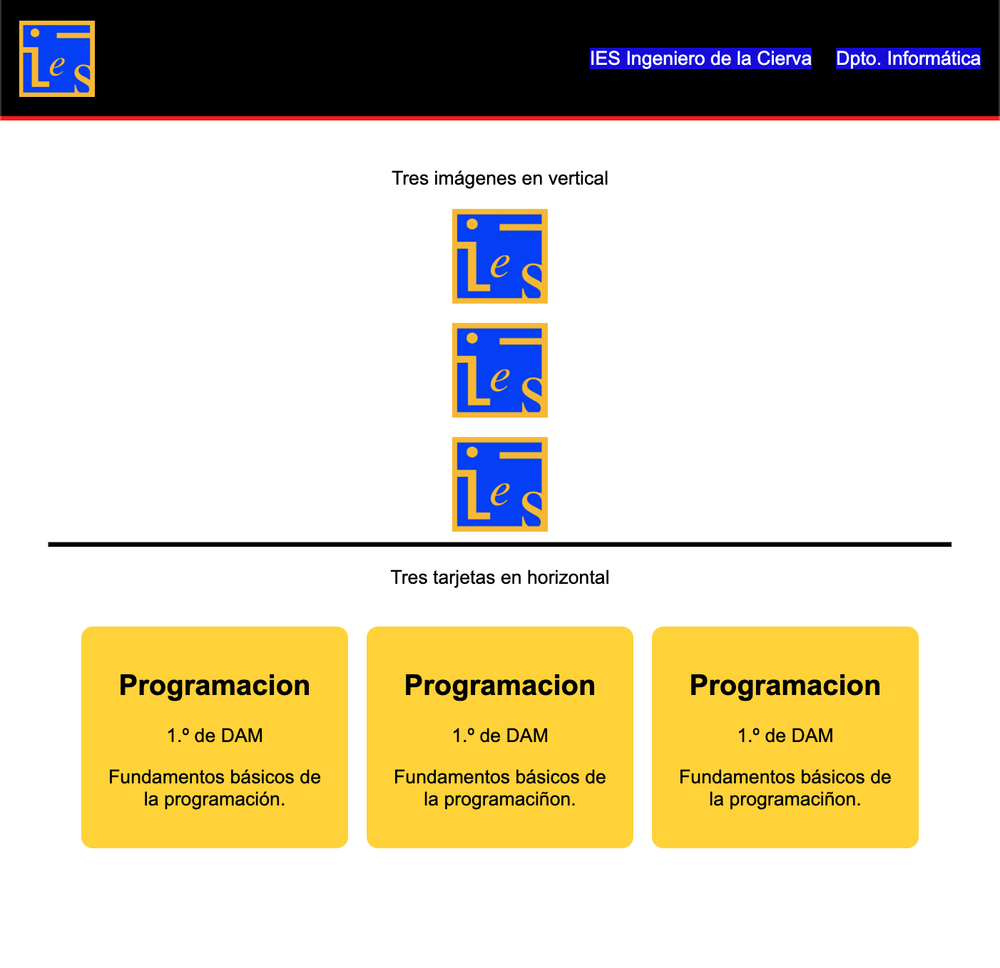
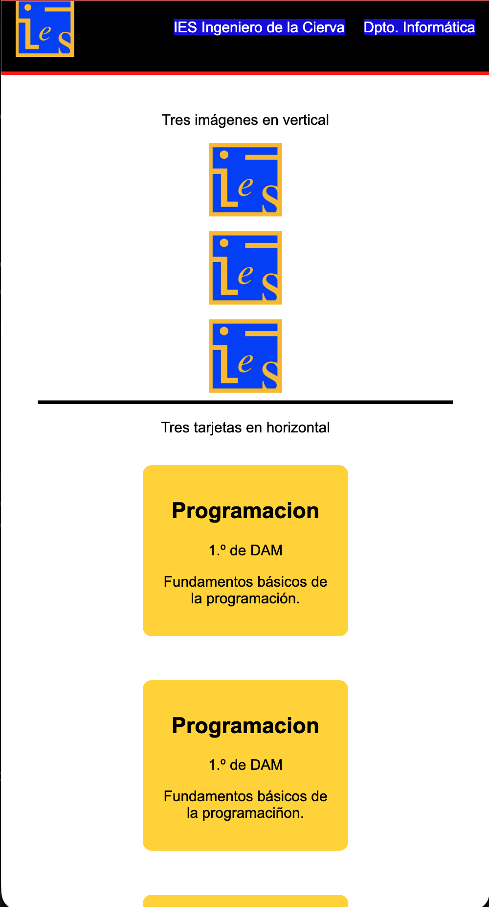

# Ejercicio DISPLAY

## Enunciado
A partir del los archivos de inicio, modifica el html y el css para llegar a la web que puedes ver a continuación. Debes usar posicionamiento flex para ello.   

### Header
El logo y las opciones del menú estan separadas.

Mete el contenido del header, el logo y el menú, en un contenedor _flex_. Usa `justify-content: space-between`

### Imagenes con el logotipo
Las tres imágenes, que por defecto se muestran en línea, deben mostrarse en vertical.

Mete las tres imágenes en un contenedor _flex_. Debes usar `flex-direction: column`

### Tarjetas
Las tres tarjetas deben mostrarse de forma flexible. Si hay espacio, en horizontal, pero si el ancho es muy pequeño, pasan a vertical, usando `flex-wrap: wrap`.

Crea primero las tarjetas, creando una clase para darle el formato indicado que ves en la imagen. Luego, mete las tres tarjetas en un contenedor _flex_. 
 
- Las tarjetas tendrán un ancho total de 300 pixeles, padding de 20 pixeles. 
- Usa `box-sizing: border-box` para no liarte con los cálculos.

### Otros
El `
` debe ser más grueso.

## Solución

## Solución con ventana pequeña

