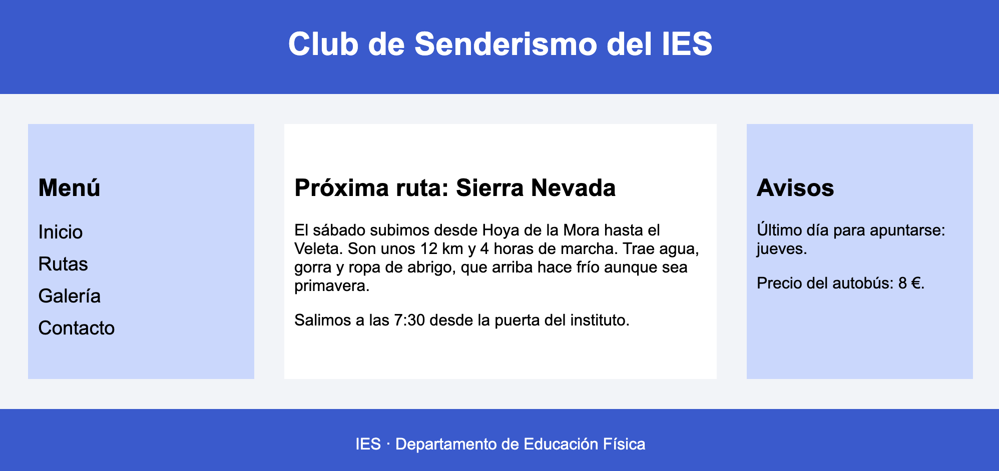
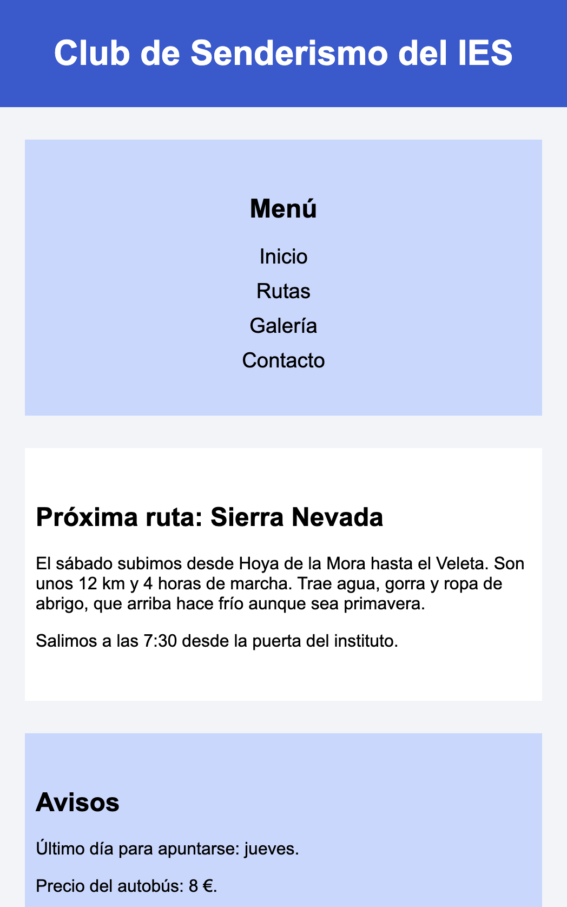

# Ejercicio DISPLAY2


A partir del los archivos de inicio, modifica el html y el css para llegar a la web que puedes ver a continuación. 




- Hay tres zonas: el menú, la zona central y la zona de avisos (esta última es un `<aside>`). 

- La zona central con la información de la ruta debe ocupar el doble que el menú y el aside. Usa para ello flex:2 y flex:1

- La zona del menú tiene el texto centrado y con un tamaño mayor, por ejemplo `1.5rem`. 


### Diseño responsive
Si no damos un ancho específico a las zonas, en una ventana pequeña se hacen demasiado pequeñas (pruébalo).
Lo idel es que se apilen debajo las zonas, pero si aplicas en este ejercicio `flex-wrap:wrap` no se apilan porque decrecen, no hay un ancho mínimo. Se podría solucionar dando un ancho mínimo, pero es más sencillo usar una media query. 

Por debajo de 600px, el contedor pasa a coolumna y también queremos que el texto del menú aparezca centrado.

```css
@media (max-width: 600px) { 
  .contenedor-flex { 
    flex-direction: column; 
  } 
}
```



