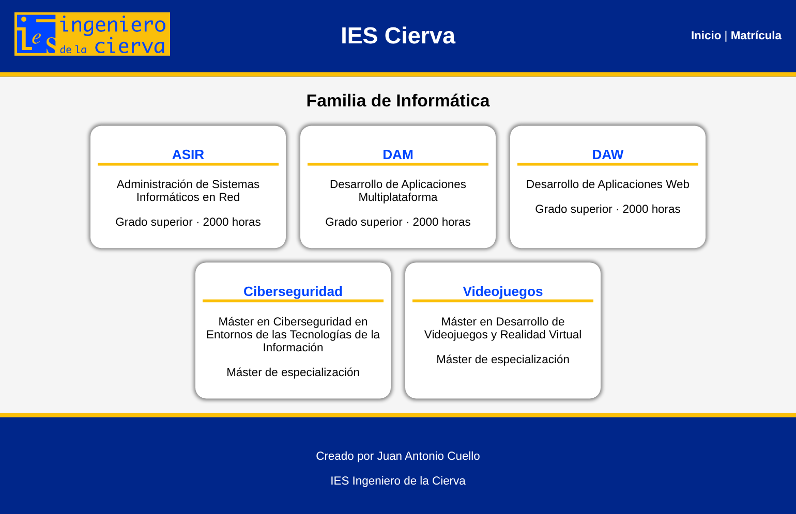
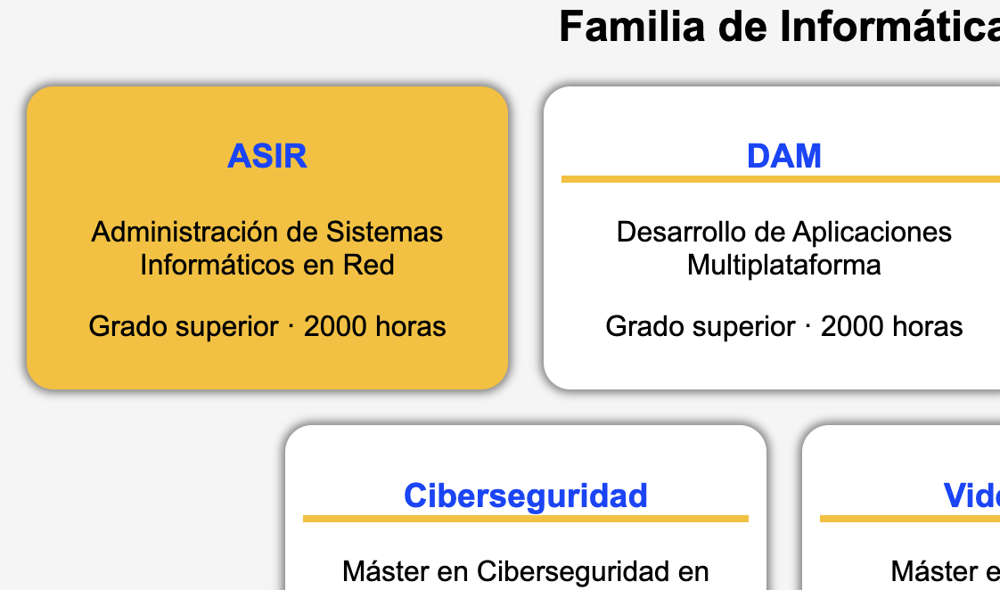
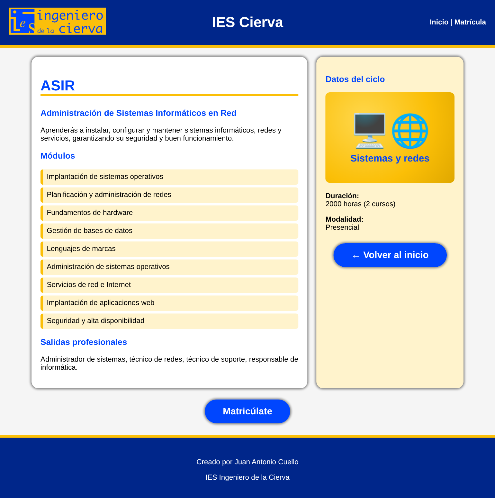
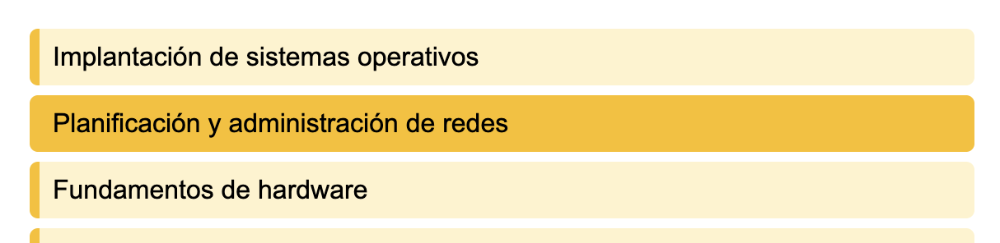
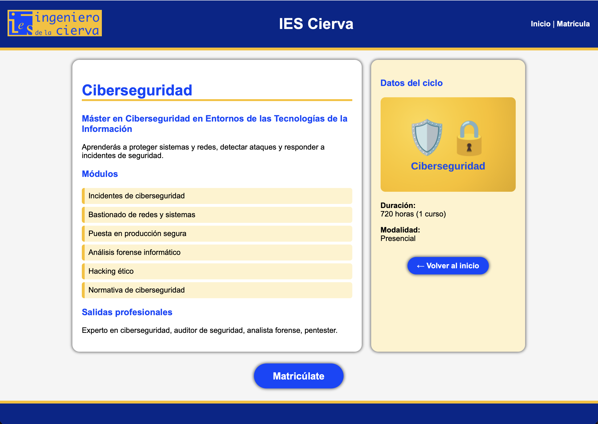
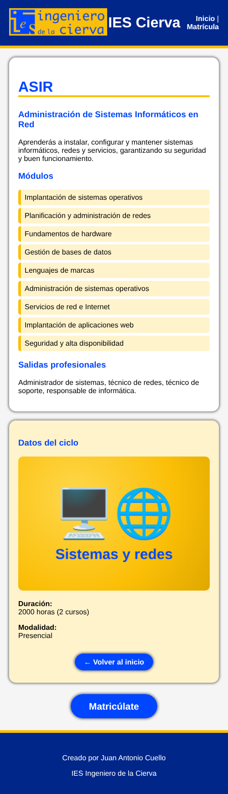
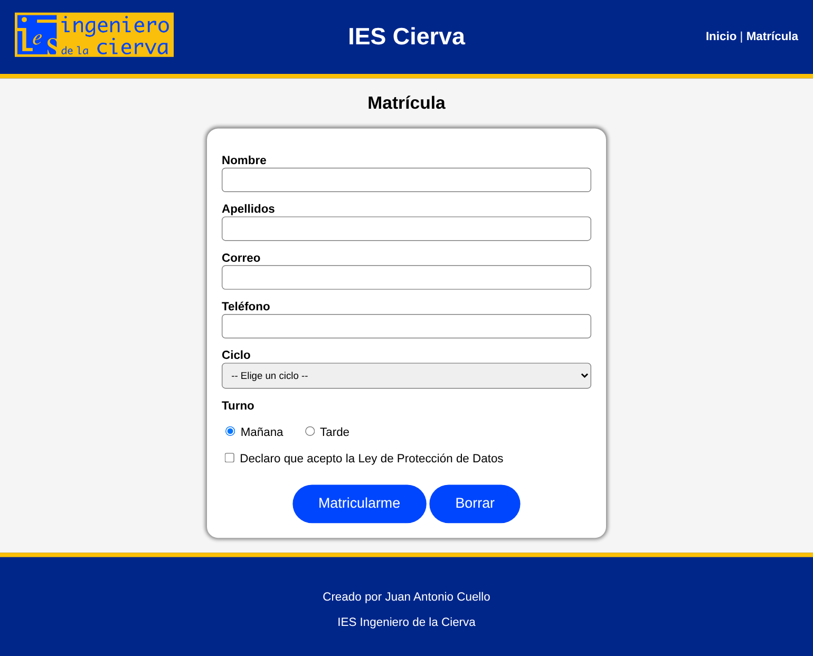

# Tarea - Familia Informática del IES Cierva

## Enunciado
Crea una mini web con los ciclos de la familia de Informática del instituto. Estará formada por estas páginas html:
- index.html
- matricula.html
- Una página de detalle por cada ciclo: asir.html, dam.html, daw.html, ciberseguridad.html y videojuegos.html

Algunas consideraciones:
- Fijate en las capturas del enunciado, para ver como tiene que quedar el diseño final.   

- Todas las páginas tienen la misma **cabecera**: el logotipo a la izquierda, el título **IES Cierva** en el centro y el menú **Inicio | Matrícula** a la derecha. Usa un contenedor flexible con `justify-content: space-between`.

- En el pie de página, pon tu nombre y apellidos.

- Los colores de la web son el azul (`#0046fe`) y el dorado (`#fbbf07`). La cabecera y el pie tienen fondo azul oscuro (`#00268a`) con una franja dorada (`border-bottom` en la cabecera y `border-top` en el pie).   

- Los enlaces de la web no se subrayan. Al pasar el ratón por encima:
    - Las opciones del menú pasan a doradas
    - Los botones fondo azul y texto oro.

- Usa una sola hoja de estilos `css/estilos.css` para toda la web.

- Las cajas (tarjetas, artículo, datos del ciclo y formulario) llevan sombreado. Es este: `box-shadow: 0px 0px 5px 2px grey`. 

- En la carpeta `recursos` tienes el logotipo y resto de imágenes. Cópialos en tu carpeta `img`.


## Página index.html

Muestra una tarjeta por cada ciclo: ASIR, DAM y DAW (grado superior) y los másteres de especialización en Ciberseguridad y en Videojuegos.
- Las tarjetas están dentro de un contenedor flexible. Tienen un ancho fijo (`width: 250px`) y, cuando no caben en una fila, bajan a la siguiente (`flex-wrap: wrap`). Quedan centradas (`justify-content: center`).
- Las tarjetas son blancas y tienen los bordes redondeados (`border-radius`).
- Cada tarjeta es un enlace a la página de detalle de su ciclo
```html
<a href="XXX">
  <div CLASE TARJETA>
        CONTENIDO DE LA TARJETA
 </div>   
</a> 
```
- Para poner en azul el titulo de la tarjeta usa selector descendente.

- Al pasar el ratón por encima de la tarjeta, la sombra pasa a amarillo. Haz la sombra un poco más grande que se note el efecto.






## Páginas de detalle (asir.html, dam.html...)**
Las cinco páginas tienen la misma estructura. Busca la información de cada ciclo en Internet.

- A la izquierda, un `<article>` con el nombre del ciclo, una descripción, la lista de módulos y las salidas profesionales.

- A la derecha, un `<aside>` con una imagen del ciclo, los datos del ciclo (duración y modalidad) y un botón para volver a inicio.

- Los dos van dentro de un contenedor flexible: el artículo ocupará de ancho el triple que el aside. Es decir, el articulo ocupa `flex: 3` y el aside `flex: 1`.

- Las dos cajas tienen los bordes redondeados. El aside tiene un fondo dorado claro (`#fff3cc`) y su imagen ocupa todo el ancho (`width: 100%`) con las esquinas redondeadas.

- Los títulos van en el azul del logo, y el nombre del ciclo lleva un borde inferior dorado. 

- La lista de módulos no lleva viñetas (`list-style: none`). Cada módulo es una caja dorada clara con un borde izquierdo dorado. Al pasar el ratón se pone dorada. Usa el selector descendiente: `article li`.

- Hay dos botones, el de volver a inicio y el de matricúlate. Ambos botones NO se hacen con la etiqueta `<button>`, puesto que no tienen ningiuna acción, a diferencia de lo que pasa en el formulario. Los haces como un párrafo y un enlace. El párrafo es para que dicho botón aparezca en otra línea, ya que si solo pones el enlace, debido a su display, aparece en la misma línea. Puedes aplicar al `<p>` algún estilo de margen para separarlo.

```html
<p><a class="boton">Matricúlate</a></p>
```









### Media query.
Cuando la ventana mide menos de 800px, las dos columnas se colocan una debajo de otra. Usa una media query `@media (max-width: 800px)` y, dentro, cambia la dirección del contenedor flexible a columna. No olvides la etiqueta `<meta name="viewport" content="width=device-width, initial-scale=1.0">` en el `<head>` de todas las páginas.




## Página matricula.html
Crea un formulario de matrícula con:
- Anchura máxima de 500 pixeles `max-width: 500px`.
- Nombre, apellidos, correo y teléfono.
- Una lista desplegable (`<select>`) para elegir el ciclo.
- Dos radio buttons para elegir el turno: mañana o tarde.
- Un checkbox "Declaro que acepto la Ley de Protección de Datos", que es obligatorio (`required`).

Debe quedar bonito:
- Cada etiqueta encima de su campo y en negrita. Y los campos ocupan todo el ancho del formulario y tienen las esquinas redondeadas. Pregunta a la IA como hacerlo.

- Los radio buttons y el checkbox van en la misma línea que su texto. Mételos en un `<div class="opcion">` y usa el selector descendiente (`.opcion input`, `.opcion label`). Pregunta a la IA como hacerlo.

- El formulario tiene los bordes redondeados, como el resto de cajas.

- Los botones van centrados (mételos en un `<div class="botones">` y dale `text-align:center`). Son grandes, azules y muy redondeados, como el botón Matricúlate. Al pasar el ratón se ponen dorados con la letra azul (`:hover`).





## Entrega
Entrega una carpeta comprimida en .zip con todas las páginas html y las carpetas `css` e `img`.
